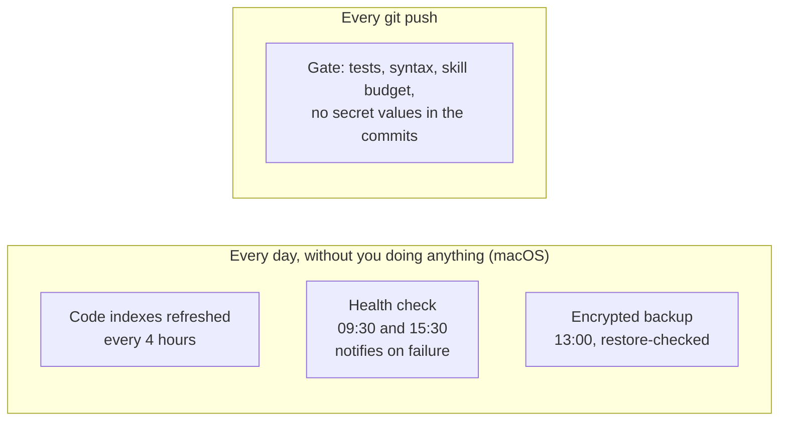

# AI-OS — AI Operating System

**Your AI coding setup in one repo, back on any machine with one command.** It covers the skills, rules, memory, MCP servers and dev environment for Claude Code, Codex, Gemini, Antigravity, Hermes and MiniMax. It follows Andrej Karpathy's Spec → Verifier → Environment method.

[](https://github.com/eddremonts86/ai-os/actions/workflows/test-mac.yml)
[](https://github.com/eddremonts86/ai-os/actions/workflows/test-linux.yml)
[](https://github.com/eddremonts86/ai-os/actions/workflows/test-windows.yml)
[](LICENSE)
[](vendor/ecc/)


*One repo is the source of truth; the installer wires it into every AI CLI on the machine.*

## What you get

- **The same assistant on every machine.** One set of skills, rules and slash commands is linked into all six AI CLIs, so they behave alike.
- **A memory that survives sessions.** A local knowledge graph remembers decisions, and every project's code is indexed for search. It runs on your machine, with no API key.
- **A setup that looks after itself.** Health checks, encrypted backups and a guard against pushing secrets run on their own (see the schedule below).
- **A way of working.** Big tasks get a written spec, plans run in small checked steps, and nothing counts as "done" until it has been shown to work.



*The routine work runs on a schedule and on every push, so you only hear about it when something breaks.*

## Start

```bash
npx @edd_remonts/create-ai-os
```

It clones the repo and runs the installer for your system. The first run takes 30–60 minutes, mostly downloads. When it finishes, `ai-os health` should be green.

## Decisions to make after installing

1. **Where your backups go off the machine.** Your memory graph, secrets file and Claude memory are backed up locally every day. On a Mac an encrypted copy also goes to iCloud Drive. A copy on GitHub is **off until you name your own private repo**, so nothing goes anywhere you did not choose. *Recommendation:* create one private repo (for example `you/ai-os-backups`) and point every machine at it. Each machine writes only its own branch, so they never overwrite each other.
2. **Save the recovery key somewhere other than this machine.** The backups are encrypted with a key kept in this Mac's Keychain. If the Mac is lost, so is the key, and the backups cannot be read. *Recommendation:* put it in your password manager now. It takes one minute.
3. **Whether you want daily backups at all.** They are on by default and you can switch them off with one command; manual backups still work. *Recommendation:* keep them on unless the machine holds nothing you would miss.
4. **The local memory needs Docker and Ollama running.** That is about 500 MB of RAM in the background, and Ollama loads a local model only while it is working. *Recommendation:* keep it. Without it the assistant forgets every decision between sessions.

**Known limits:** on Windows the installer, skills and MCP servers work, but the scheduled jobs and backups are macOS-only for now. The secrets file stays a plain file, readable only by you and git-ignored; `ai-os secrets` checks that.

---

> ## Technical notes (for people who build it)
>
> Not needed to use AI-OS. These sections explain how each piece works, using the same numbering as the decisions above, then the reference material.

---

## 1. Backups — `ai-os backup`

What is backed up is only what cannot be rebuilt: the graphiti graph (a FalkorDB RDB snapshot), `dev-env/env-config/.env` and Claude Code's per-project memory (`~/.claude/projects/*/memory`). Code indexes, skill links and MCP configs are rebuilt by the installer.

| Command | Does |
| --- | --- |
| `ai-os backup` | Take a snapshot now (keeps the newest 14) and push the encrypted copies |
| `ai-os backup --status` | Schedule, destinations, this machine's branch, newest snapshot |
| `ai-os backup --disable` / `--enable` | Unload / install the daily `ai.os.backup` agent (13:00). Re-installs, `verify.sh` and `ai-os health` respect the choice |
| `ai-os backup --github-repo OWNER/NAME` | Mirror to this repo. It must exist, be **private**, and be empty or hold only AI-OS backups |
| `ai-os backup --no-github` | Stop mirroring to GitHub (the repo is left as it is) |
| `ai-os backup --icloud off\|on` | Stop / resume the iCloud Drive copy |
| `ai-os backup --verify` | Restore the newest local snapshot into a throwaway FalkorDB and compare graph sizes |
| `ai-os backup --verify-offsite` | Decrypt the newest iCloud and GitHub copies and compare them |
| `ai-os backup --restore-offsite DIR` | Decrypt and extract the newest off-site copy |

- **Settings:** `~/.ai-os/backup.json` (`schedule`, `icloud`, `github_repo`, `branch`), local to each machine; override the path with `$AI_OS_BACKUP_CONFIG`.
- **Local copy:** `~/Backups/ai-os` (0700, files 0600) — the same disk, so it covers mistakes and corruption, not disk loss.
- **Encryption:** AES-256-GCM, one `.tar.gz.enc` per snapshot; only ciphertext leaves the machine.
- **Several machines, one repo:** each machine force-pushes only `refs/heads/<machine>` (one parentless commit, newest 14 files) and writes `Backups/ai-os/<machine>/` in iCloud. The name comes from macOS `LocalHostName` and is saved once as `branch`, so a hostname change never moves it.
- **Why the repo checks:** the mirror force-pushes. Pointed at a real project it would erase its history, so a repo with other files is refused, and so is a public one.
- **Restore on a new machine:** `AI_OS_BACKUP_KEY=<key> AI_OS_GITHUB_BACKUP_REPO=OWNER/NAME AI_OS_BACKUP_BRANCH=<old machine> ai-os backup --restore-offsite <dir>`. Use `AI_OS_RESTORE_FROM=github` to skip iCloud.
- **Daily job:** backup, then `--verify`, then `--verify-offsite`; a macOS notification on failure; logs in `memory/logs/backup-*.log` (30 days).

## 2. Recovery key and secrets

- `ai-os backup --show-key` prints the key (run it in your own terminal). Once it is saved elsewhere, `ai-os backup --confirm-key-saved` silences the health warning.
- `dev-env/env-config/.env` is the single merged secrets file that scripts read. It stays a plain file (0600, git-ignored, FileVault on): dozens of scripts read it, and the Keychain would not protect it better from your own processes. `ai-os secrets` checks those properties. `ai-os secrets audit` scans the history and tracked files of every local repo for its values, and reports key names, repo, visibility and a verdict, never a value.
- The pre-push hook runs `ai-os secrets check-push` on exactly the commits being pushed, and refuses the push if one contains a credential-like `.env` value.

## 3. Memory stack and MCP servers

| Piece | What it does |
| --- | --- |
| `graphiti` on FalkorDB | Temporal knowledge graph of decisions and facts; entity extraction by the host's Ollama (`gemma3:12b`), so no API key |
| `codebase-memory-mcp` | AST knowledge graph of every indexed repo, reindexed every 4 hours by `ai.os.reindex` |
| `grepai` | Semantic code search over Ollama embeddings |
| Ollama | Local LLM and embeddings, `:11500` (`OLLAMA_HOST` in `~/.ai-os/env.sh`) |

`ai-os memory start|status|reindex` operates it; the `ai-os-memory` skill covers repairs. When to read and write memory: `rules/always_do.md` "Use the memory stack".

There are **11 MCP servers (8 enabled)**, declared as YAML in `ai-config/mcp/*.yaml` (`time`, `pdf`, `chrome`, `agent-browser`, `codebase-memory-mcp`, `grepai`, `graphiti`). `setup/generate-mcp-config.py` and `setup/sync-ide-mcp-servers.py` write them into Hermes, Claude Code, Codex, Gemini and VS Code, removing disabled ones. `memory`, `filesystem` and `sequential-thinking` are disabled; the reasons are in each YAML.

## 4. Platforms

| | macOS | Windows | Linux |
| --- | --- | --- | --- |
| Installer, skills, MCP, commands | ✅ | ✅ (symlink → junction/hard-link fallback without admin) | ✅ |
| Scheduled agents (reindex, health, backup) | ✅ launchd | ❌ not yet | ❌ not yet |
| Backups (Keychain key, iCloud) | ✅ | ❌ not yet | ❌ not yet |
| Shell | zsh + Oh My Zsh + p10k, Warp | PowerShell, Windows Terminal | bash/zsh |

Details: [`docs/cross-platform.md`](docs/cross-platform.md).

---

## Reference

### Install

`npx @edd_remonts/create-ai-os [DIR]` clones the repo and runs `setup/install-mac.sh` (Mac/Linux) or `setup/install-windows.ps1`. `--clone-only` skips the installer. The installer is idempotent, prints what it will install and asks first, and never upgrades pinned versions. `DRY_RUN=1 bash setup/install-mac.sh` simulates everything (this is what CI runs).

It installs Homebrew packages from `dev-env/packages/Brewfile` (37 packages, plus extras with `EXTRAS=1`), npm and Python globals, Oh My Zsh + p10k, and dotfile symlinks. It also links the skills into every CLI and generates the MCP config from `ai-config/mcp/*.yaml` (8 servers). Finally it installs the launchd agents and the pre-push hook, and runs verification (20 sections). Check the result with `bash setup/verify.sh` (what is installed) and `ai-os health` (what works).

### The `ai-os` command

| Command | Does |
| --- | --- |
| `ai-os health [--json\|--notify]` | 15 functional checks: graph, MCP, memory, tokens, CI, secrets, backups. Runs at 09:30 and 15:30 |
| `ai-os backup …` | See [§1](#1-backups--ai-os-backup) |
| `ai-os secrets [audit\|check-push]` | See [§2](#2-recovery-key-and-secrets) |
| `ai-os memory …` | Memory stack: start, status, browse, reindex |
| `ai-os update [--apply COMPONENT]` | Pinned vs upstream versions; `--apply` bumps one, runs its health checks, rolls back on failure |
| `ai-os stats [--check\|--write]` | Counts the site and this README publish, computed from the repo; `--write` fixes them and re-renders the images |
| `ai-os skills [lint\|route\|bank]` | Skill catalogue budget, near-duplicate descriptions, routing regression bank |
| `ai-os project init [PATH]` | Give a project a short `CLAUDE.md`, `.agents/skills/` and the secret-leak `.gitignore` lines |
| `ai-os loop`, `ai-os llm`, `ai-os plans`, `ai-os bootstrap` | Loop runner, local/cloud chat router, plan documents (needs `PLANSMITH_ROOT`), full-stack bootstrap |

### Skills

- **Global skills** live in `ai-config/skills/<name>/` and are symlinked into every CLI. They include **14 required [superpowers](https://github.com/obra/superpowers)**, **+14 curated ECC skills** (`vendor/ecc/`) and a few vendored ones (claude.tools, gstack, diagram-design, archify). Inventory: [`docs/skills-catalog.md`](docs/skills-catalog.md).
- **Project skills** live in `<project>/.agents/skills/` and are not propagated.
- **Budget:** every skill's description is loaded into every session. `ai-os skills lint` keeps the always-loaded text near 10K tokens (hard cap 500 characters per description, target 350) and flags near-duplicates. `ai-os skills bank` routes typical requests as a regression alarm. Both run in the pre-push hook.
- **PR workflow:** `file-pr` (problem-first PR descriptions), `babysit-pr` (watch CI and review bots without polling) and `full-stop` (take a change to a ready PR unattended, never merge), adapted from [`t3dotgg/tstack`](https://github.com/t3dotgg/tstack). Notes: [`docs/theo-patterns.md`](docs/theo-patterns.md).
- **Documents:** `two-layer-doc`: anything others will read gets a plain front layer, a divider, then the technical layer (this README).
- **Slash commands** (`/action`, `/full`, `/gen-html`, `/saas-review`, `/fix-ui-ux`, …) are skills plus Markdown sources in `ai-config/commands/` for VS Code prompts and Gemini TOML.

### The method

Every substantial task runs **Spec → Plan → Execute → Verify**. A spec (`specs/current_spec.md`, from `specs/spec_template.md`) is required only for work over ~2 hours, across repos, or on request. Plans are small checked steps, run in parallel sub-agents when independent. "Done" needs runtime evidence, not only a green build. Completed specs are archived to `archive/`.

The rules are in `rules/always_do.md`, `rules/ask_before_doing.md` and `rules/never_do.md`. The workflows are in `workflows/` (daily start, project start, coding, research, content). The optional verifiers are in `verifiers/`. The master instructions are in [`CLAUDE.md`](CLAUDE.md) (`AGENTS.md` is a symlink to it).

### Repository layout

Everything above `apps/` is the operating system; everything from `apps/` down is what it produced.

```
context/      who I am, projects, preferences, tools, sources
rules/        always do / ask before doing / never do
workflows/    recurring processes      specs/  one active spec + template
verifiers/    optional review prompts  archive/ completed specs
ai-config/    skills/, commands/, mcp/*.yaml, templates/
dev-env/      dotfiles, packages (Brewfile, npm, pip), env-config/.env (git-ignored)
memory/       docker-compose for the memory stack, launchd agents, logs
setup/        installers, verify, the ai-os CLIs (health, backup, secrets, …), hooks/, tests/
vendor/       ecc, gstack, codex-plugin-cc
docs/         reference docs
apps/         site/ (the landing), create-ai-os/ (the npm bootstrapper)
```

The plans product moved to its own repo, **plansmith**, on 2026-09-25. What must not be "tidied" (`AGENTS.md` symlink, root `Dockerfile` addressed by Coolify, `outputs/`): [`docs/repo-layout.md`](docs/repo-layout.md).

### Git flow and CI

- Work on a feature branch from `dev`, open a PR to `dev`, then promote `dev` → `main` with a PR. `guard-main.yml` accepts PRs into `main` only from `dev`; the pre-push hook blocks direct pushes to `main`.
- **Pre-push gate** (`setup/hooks/pre-push`, enabled by the installer via `core.hooksPath`): runs on the exact commit being pushed. It checks shell/node syntax, YAML and skill frontmatter, the skill budget and routing, compose config, published numbers (`ai-os stats --check`), `.env` values in the push, unit tests and the install dry-runs.
- **CI:** `test-mac.yml`, `test-linux.yml` and `test-windows.yml` run the dry-run installers and unit tests. `image.yml` builds the images Coolify ships, and `deploy-site.yml` deploys `apps/site`.

### Contributing

Add a global skill as `ai-config/skills/<name>/SKILL.md`, an MCP server as `ai-config/mcp/<name>.yaml`, or a workflow as `workflows/<name>.md`. Then open a PR to `dev`; the gate and CI validate it. Guide: [`docs/sharing.md`](docs/sharing.md). Per-CLI invocation: [`docs/cli-reference.md`](docs/cli-reference.md).

## License

[MIT](LICENSE) — Eduardo Schilling, 2026.
