<picture>
  <source media="(prefers-color-scheme: light)" srcset="docs/images/readme-hero-light.png">
  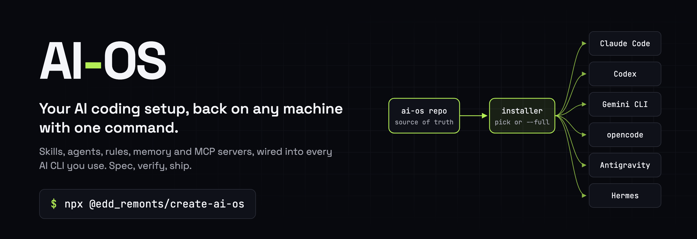
</picture>

<p align="center">
  <a href="https://github.com/eddremonts86/ai-os/actions/workflows/test-mac.yml"></a>
  <a href="https://github.com/eddremonts86/ai-os/actions/workflows/test-linux.yml"></a>
  <a href="https://github.com/eddremonts86/ai-os/actions/workflows/test-windows.yml"></a>
  <a href="https://www.npmjs.com/package/@edd_remonts/create-ai-os"></a>
  <a href="LICENSE"></a>
</p>

<p align="center">
  <a href="#start">Start</a> ·
  <a href="#how-it-works">How it works</a> ·
  <a href="#how-a-task-runs">How a task runs</a> ·
  <a href="#commands">Commands</a> ·
  <a href="#design-with-themes">Design</a> ·
  <a href="#agents">Agents</a> ·
  <a href="#decisions-to-make-after-installing">After installing</a> ·
  <a href="#technical-notes">Technical notes</a>
</p>

# AI-OS — AI Operating System

**Your AI coding setup in one repo, back on any machine with one command.** It covers the skills, rules, memory, MCP servers and dev environment for Claude Code, Codex, Gemini, Antigravity, Hermes and MiniMax. It follows Andrej Karpathy's Spec → Verifier → Environment method.

[](vendor/ecc/)

## What you get

| You get | What it means |
|---|---|
| **The same assistant on every machine** | One set of skills, 19 agents, rules and slash commands reaches all six AI CLIs, so they behave alike. |
| **A memory that survives sessions** | A local knowledge graph remembers decisions, and every project's code is indexed for search. It runs on your machine, with no API key. |
| **A setup that looks after itself** | Health checks, encrypted backups and a guard against pushing secrets run on their own, so you only hear about it when something breaks. |
| **A way of working** | Big tasks get a written spec, plans run in small checked steps, and nothing counts as "done" until it has been shown to work. |

## Start

```bash
npx @edd_remonts/create-ai-os
```

It clones the repo, lets you choose the AI CLIs, the components and **every package one by one**, and runs the installer for your system. `--full` installs every CLI, component and package without asking (your shell and terminal look only change if you opt in). The first run takes 30–60 minutes, mostly downloads. When it finishes, `ai-os health` should be green.

<table>
  <tr>
    <td width="50%">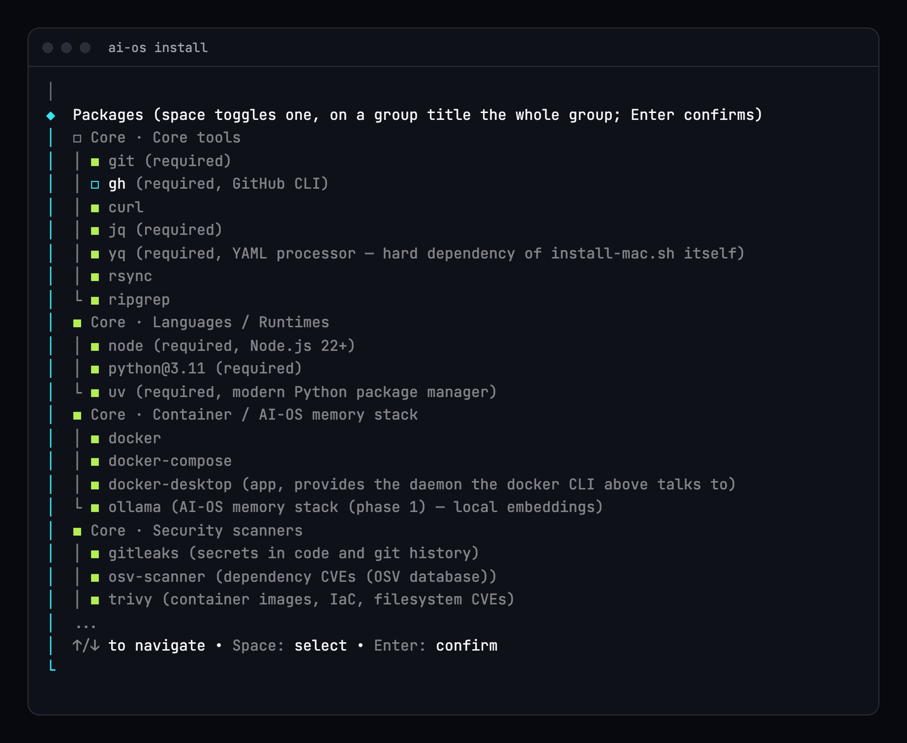</td>
    <td width="50%">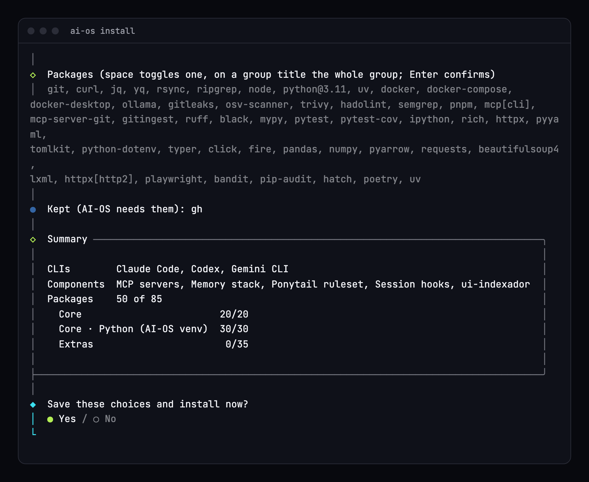</td>
  </tr>
  <tr>
    <td><sub>Every package, grouped as in the Brewfile. The ones AI-OS runs on are marked <i>required</i> and stay.</sub></td>
    <td><sub>One summary, one confirmation. The choice is saved, so <code>ai-os install</code> starts from it next time.</sub></td>
  </tr>
</table>

Already have a clone? `ai-os install` reopens the selector; `bash setup/install-mac.sh --full` installs everything.

## How it works

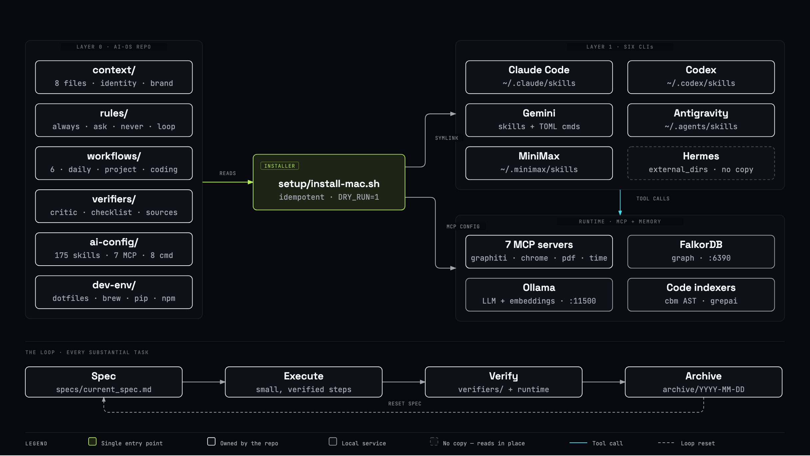

*One repo is the source of truth; the installer wires it into every AI CLI on the machine.*

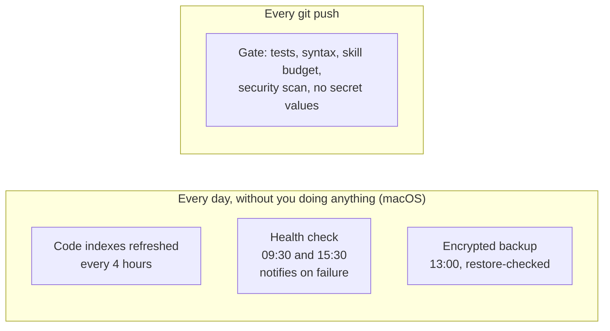

*The routine work runs on a schedule and on every push.*

## How a task runs

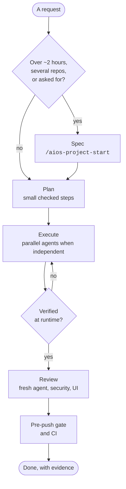

*"Done" means shown to work: a test run, a browser screenshot, a live URL. A green build alone is not enough.*

## Commands

### The `ai-os` command

| Command | Does |
| --- | --- |
| `ai-os install [--full\|--yes]` | Choose the AI CLIs, components and every package, then run the installer (`--full`: all of it) |
| `ai-os health [--json\|--notify]` | 15 functional checks: graph, MCP, memory, tokens, CI, secrets, backups. Runs at 09:30 and 15:30 |
| `ai-os backup …` | See [Backups](#1-backups--ai-os-backup) |
| `ai-os secrets [audit\|check-push]` | See [Recovery key and secrets](#2-recovery-key-and-secrets) |
| `ai-os memory …` | Memory stack: start, status, browse, reindex |
| `ai-os update [--apply COMPONENT]` | Pinned vs upstream versions; `--apply` bumps one, runs its health checks, rolls back on failure |
| `ai-os stats [--check\|--write]` | Counts the site and this README publish, computed from the repo; `--write` fixes them and re-renders the images |
| `ai-os agents [--check]` | Write `ai-config/agents` (and your `context/personal/agents`) into Claude Code, Codex, Gemini CLI and opencode |
| `ai-os scope [which\|git-config --apply\|check-push\|check-tree]` | Which scope a folder is in (personal, employer, own company): its design system, git identity and confidentiality guard |
| `ai-os skills [lint\|route\|bank]` | Skill catalogue budget, near-duplicate descriptions, routing regression bank |
| `ai-os project init [PATH]` | Give a project a short `CLAUDE.md`, `.agents/skills/` and the secret-leak `.gitignore` lines |
| `ai-os loop`, `ai-os llm`, `ai-os plans`, `ai-os bootstrap` | Loop runner, local/cloud chat router, plan documents (needs `PLANSMITH_ROOT`), full-stack bootstrap |

### Slash commands

Type these in any CLI (Claude Code, Codex, Gemini CLI, opencode, Antigravity). Each is a skill in `ai-config/skills/` (VS Code prompts and Gemini TOML come from `ai-config/commands/`). Every `aios-*` command runs only when you call it.

#### UI and design

Which one to use:

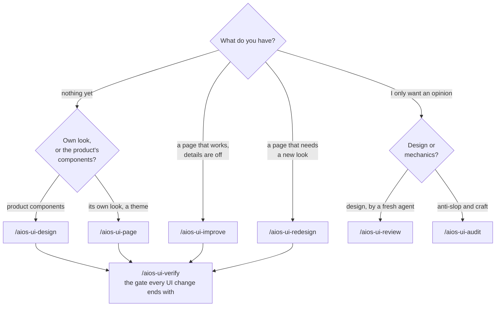

| Command | Does |
|---|---|
| `/aios-ui-design` | Build a new page, screen or component from proven pieces (ui-indexador), one section shown first |
| `/aios-ui-page` | A standalone page, component or app screen with its own look, in a dealt, named or custom theme (Hallmark) |
| `/aios-ui-themes` | Browse, deal and apply Hallmark's 50 themes, or lock a system into `DESIGN.md` |
| `/aios-ui-photos` | Openly licensed photos for a page, with credits |
| `/aios-ui-improve` | Fix an existing UI, proven with before and after screenshots |
| `/aios-ui-redesign` | A new look for an existing page or app, content and wiring kept |
| `/aios-ui-review` | A cold, read-only design review by a fresh agent |
| `/aios-ui-audit` | Read-only anti-slop and craft audit in a real browser |
| `/aios-ui-verify` | The runtime gate: 375/768/1280 px, light and dark, console, overflow, accessibility, anti-slop lint |
| `/aios-ui-3d` | A 3D scene or WebGL/shader piece |
| `/aios-ui-video` | A video in code (Remotion or rendered frames) |
| `/saas-review` | Every route of an app scored on 21 criteria, prioritised findings |
| `/fix-ui-ux` | Find and fix every UI/UX defect of a product (Impeccable end to end) |
| `/optimize-mobile` | Every route at 320 to 768 px, verified in iOS Safari, fixed |
| `/pick-ui-library` | The one library for a frontend task (toasts, charts, drag and drop…) |
| `/hallmark` | Hallmark itself, when you name it (`/hallmark redesign <path>`, `/hallmark audit <path>`) |

<details>
<summary><b>Work</b>: specs, code, research, docs, loops, memory</summary>

| Command | Does |
|---|---|
| `/aios-project-start` | Write a Spec for a task over ~2 hours or across repos (`specs/current_spec.md`) |
| `/aios-code` | Implement, fix, refactor or add tests with the AI-OS coding workflow |
| `/aios-research` | Investigate a question, compare options, evaluate a tool |
| `/aios-content` | Docs, ADRs, tutorials, release notes |
| `/aios-loop` | A reusable loop (TASK, INSTRUCTIONS, PROGRESS) with blast-radius levels, for recurring work |
| `/aios-memory` | Inspect or repair the memory stack (graphiti, Ollama, code indexers) |
| `/aios-pr-learnings` | Learn a repo's unwritten review rules from its PR comments, pre-review a diff against them |
| `/aios-quickstart`, `/aios-karpathy` | Bootstrap or load AI-OS in a CLI |

</details>

<details>
<summary><b>Ship</b>: from idea to a ready PR</summary>

| Command | Does |
|---|---|
| `/full` (`/action`) | Spec, plan, build, review, simplify, ship in one run (`/action` stops at reviewed code) |
| `/full-stop` | Take a change to a ready PR unattended; never merges |
| `/file-pr` | A PR description that leads with the problem |
| `/babysit-pr` | Watch a PR through CI and review bots until green |
| `/build-fix` | Fix a failing build or typecheck with the smallest diff |
| `/improve-codebase-architecture` | Find deepening opportunities, as a visual report |
| `/gen-html` | A self-contained HTML document (spec, plan, report, UI mock) |
| `/vue-review` | Vue code review (Composition API, reactivity, security) |

</details>

<details>
<summary><b>Security</b>: review, audit, fix</summary>

| Command | Does |
|---|---|
| `/aios-security-review` | A branch or PR before merge: scanners on what it adds, then a code review |
| `/aios-security-audit` | The whole app: every scanner, then what scanners miss |
| `/aios-security-fix` | Fix confirmed findings one at a time, each with a test |

</details>

## Design with themes

`/aios-ui-themes deal "<your brief>"` deals three of [Hallmark](ai-config/skills/hallmark/VENDORED_FROM.md)'s 50 themes for the brief; `/aios-ui-page` builds the page in the one you pick, under a hard anti-slop floor, linted in a real browser. A few of them:

<table>
  <tr>
    <td width="25%">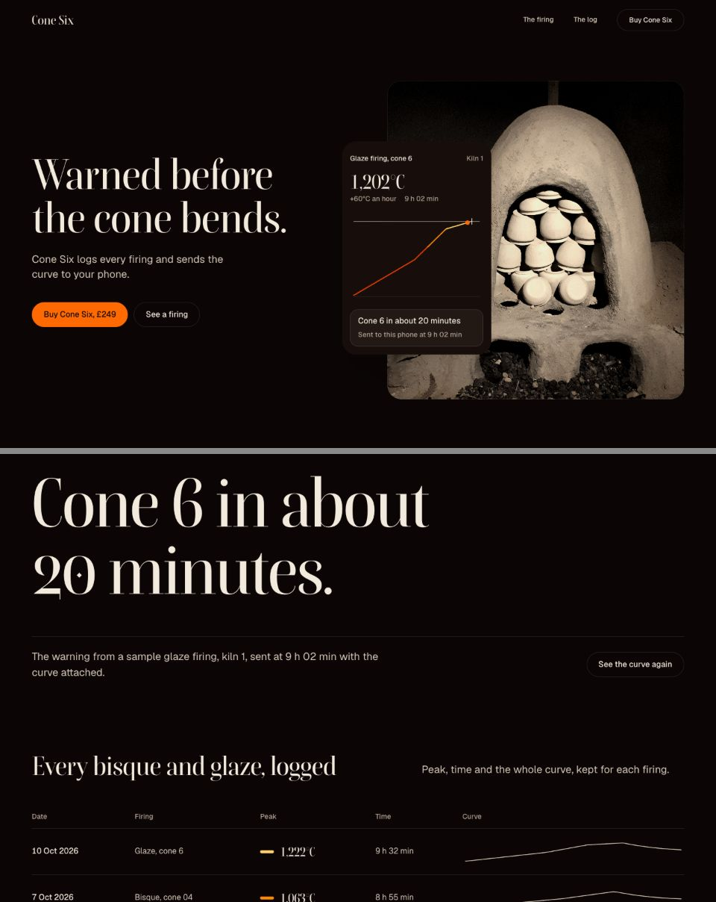</td>
    <td width="25%">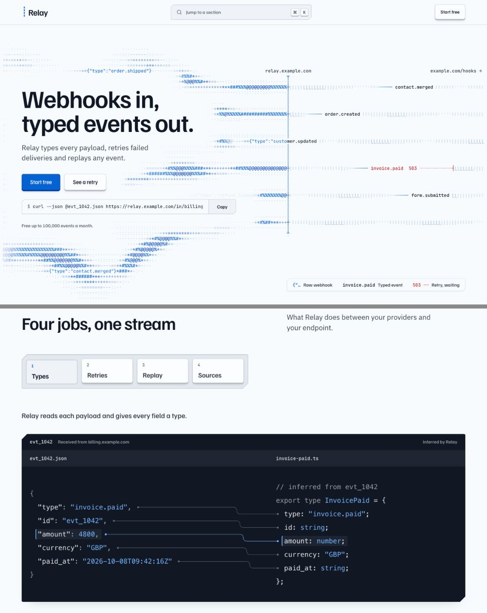</td>
    <td width="25%"></td>
    <td width="25%">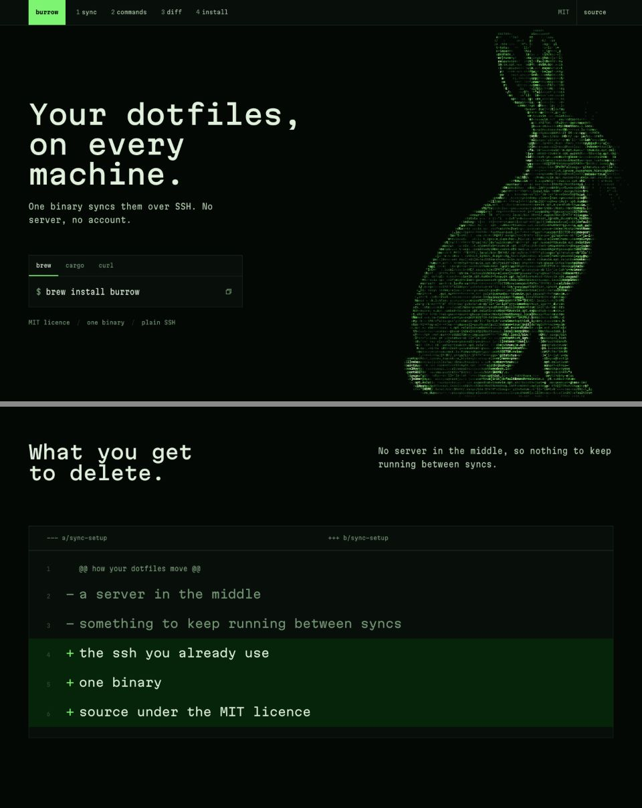</td>
  </tr>
  <tr>
    <td align="center"><sub><b>Kiln</b></sub></td>
    <td align="center"><sub><b>Cobalt</b></sub></td>
    <td align="center"><sub><b>Atelier</b></sub></td>
    <td align="center"><sub><b>Terminal</b></sub></td>
  </tr>
</table>

`/aios-ui-themes apply <slug>` maps a theme's tokens onto your project's own names (shadcn's `--background`, `--primary`…), and `lock` writes them to `DESIGN.md`. The same linter runs on any project in `/aios-ui-verify` and `/aios-ui-audit`.

## Agents

**19 shared agents** live in `ai-config/agents/` (one Markdown file each; yours go in `context/personal/agents/`, git-ignored, and replace a shared one of the same name). `ai-os agents`, also run by the installer, writes each one in the CLI's own format: Claude Code, Gemini CLI and opencode get Markdown, Codex gets TOML. A file you wrote yourself in those folders is never overwritten. Ask for one by name ("use the security-reviewer agent", `@ui-reviewer` in Gemini), or let the CLI pick it from its description.

| Area | Agents |
|---|---|
| Writing and docs | `docs-writer`, `docs-drift-checker`, `source-checker` |
| Review | `aios-reviewer`, `fresh-reviewer` (cold review of a Spec or plan) |
| Code | `root-cause-debugger`, `test-writer`, `windows-porter`, `installer-tester` |
| Security | `security-reviewer`, `threat-modeler`, `supply-chain-vetter` |
| Design | `ui-reviewer`, `a11y-auditor`, `design-system-keeper` |
| Performance and stability | `perf-auditor`, `bundle-optimizer`, `rerender-hunter`, `stability-tester` |

The reviewers are read-only (enforced in Claude Code and opencode; on Codex and Gemini only by their instructions). `/aios-security-review` and `/aios-ui-review` hand their fresh review to `security-reviewer` and `ui-reviewer`. What each one does: [`ai-config/agents/README.md`](ai-config/agents/README.md).

## Decisions to make after installing

1. **Where your backups go off the machine.** Your memory graph, secrets file and Claude memory are backed up locally every day. On a Mac an encrypted copy also goes to iCloud Drive. A copy on GitHub is **off until you name your own private repo**, so nothing goes anywhere you did not choose. *Recommendation:* create one private repo (for example `you/ai-os-backups`) and point every machine at it. Each machine writes only its own branch, so they never overwrite each other.
2. **Save the recovery key somewhere other than this machine.** The backups are encrypted with a key kept in this Mac's Keychain. If the Mac is lost, so is the key, and the backups cannot be read. *Recommendation:* put it in your password manager now. It takes one minute.
3. **Whether you want daily backups at all.** They are on by default and you can switch them off with one command; manual backups still work. *Recommendation:* keep them on unless the machine holds nothing you would miss.
4. **The local memory needs Docker and Ollama running.** That is about 500 MB of RAM in the background, and Ollama loads a local model only while it is working. *Recommendation:* keep it. Without it the assistant forgets every decision between sessions.

**Known limits:** on Windows the installer, skills and MCP servers work, but the scheduled jobs and backups are macOS-only for now. The secrets file stays a plain file, readable only by you and git-ignored; `ai-os secrets` checks that.

---

## Technical notes

> Not needed to use AI-OS. These sections explain how each piece works, using the same numbering as the decisions above, then the reference material.

### 1. Backups — `ai-os backup`

What is backed up is only what cannot be rebuilt: the graphiti graph (a FalkorDB RDB snapshot), `dev-env/env-config/.env` and Claude Code's per-project memory (`~/.claude/projects/*/memory`). Code indexes, skill links and MCP configs are rebuilt by the installer.

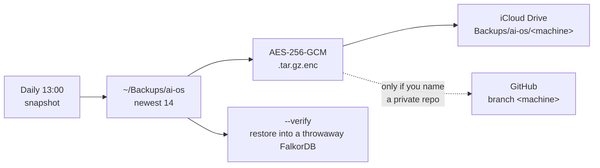

| Command | Does |
| --- | --- |
| `ai-os backup` | Take a snapshot now (keeps the newest 14) and push the encrypted copies |
| `ai-os backup --status` | Schedule, destinations, this machine's branch, newest snapshot |
| `ai-os backup --disable` / `--enable` | Unload / install the daily `ai.os.backup` agent (13:00). Re-installs, `verify.sh` and `ai-os health` respect the choice |
| `ai-os backup --github-repo OWNER/NAME` | Mirror to this repo. It must exist, be **private**, and be empty or hold only AI-OS backups |
| `ai-os backup --no-github` | Stop mirroring to GitHub (the repo is left as it is) |
| `ai-os backup --icloud off\|on` | Stop / resume the iCloud Drive copy |
| `ai-os backup --verify` | Restore the newest local snapshot into a throwaway FalkorDB and compare graph sizes |
| `ai-os backup --verify-offsite` | Decrypt the newest iCloud and GitHub copies and compare them |
| `ai-os backup --restore-offsite DIR` | Decrypt and extract the newest off-site copy |

- **Settings:** `~/.ai-os/backup.json` (`schedule`, `icloud`, `github_repo`, `branch`), local to each machine; override the path with `$AI_OS_BACKUP_CONFIG`.
- **Local copy:** `~/Backups/ai-os` (0700, files 0600) — the same disk, so it covers mistakes and corruption, not disk loss.
- **Encryption:** AES-256-GCM, one `.tar.gz.enc` per snapshot; only ciphertext leaves the machine.
- **Several machines, one repo:** each machine force-pushes only `refs/heads/<machine>` (one parentless commit, newest 14 files) and writes `Backups/ai-os/<machine>/` in iCloud. The name comes from macOS `LocalHostName` and is saved once as `branch`, so a hostname change never moves it.
- **Why the repo checks:** the mirror force-pushes. Pointed at a real project it would erase its history, so a repo with other files is refused, and so is a public one.
- **Restore on a new machine:** `AI_OS_BACKUP_KEY=<key> AI_OS_GITHUB_BACKUP_REPO=OWNER/NAME AI_OS_BACKUP_BRANCH=<old machine> ai-os backup --restore-offsite <dir>`. Use `AI_OS_RESTORE_FROM=github` to skip iCloud.
- **Daily job:** backup, then `--verify`, then `--verify-offsite`; a macOS notification on failure; logs in `memory/logs/backup-*.log` (30 days).

### 2. Recovery key and secrets

- `ai-os backup --show-key` prints the key (run it in your own terminal). Once it is saved elsewhere, `ai-os backup --confirm-key-saved` silences the health warning.
- `dev-env/env-config/.env` is the single merged secrets file that scripts read. It stays a plain file (0600, git-ignored, FileVault on): dozens of scripts read it, and the Keychain would not protect it better from your own processes. `ai-os secrets` checks those properties. `ai-os secrets audit` scans the history and tracked files of every local repo for its values, and reports key names, repo, visibility and a verdict, never a value.
- The pre-push hook runs `ai-os secrets check-push` on exactly the commits being pushed, and refuses the push if one contains a credential-like `.env` value.

### 3. Memory stack and MCP servers

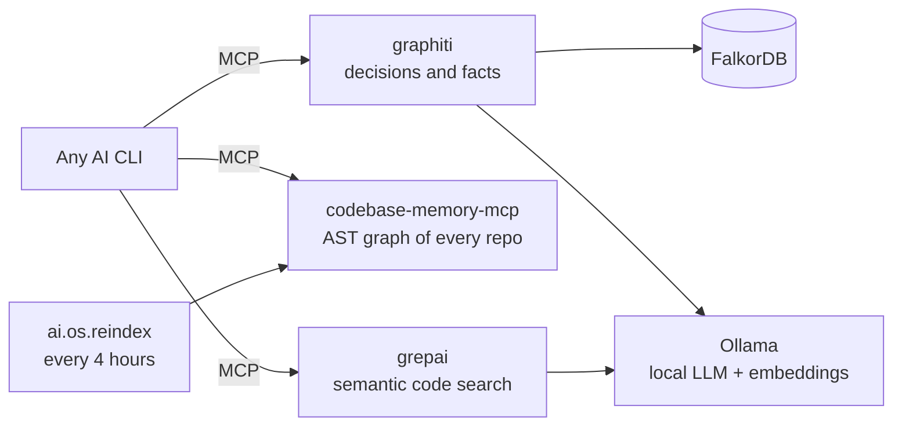

| Piece | What it does |
| --- | --- |
| `graphiti` on FalkorDB | Temporal knowledge graph of decisions and facts; entity extraction by the host's Ollama (`gemma3:12b`), so no API key |
| `codebase-memory-mcp` | AST knowledge graph of every indexed repo, reindexed every 4 hours by `ai.os.reindex` |
| `grepai` | Semantic code search over Ollama embeddings |
| Ollama | Local LLM and embeddings, `:11500` (`OLLAMA_HOST` in `~/.ai-os/env.sh`) |

`ai-os memory start|status|reindex` operates it; the `aios-memory` skill covers repairs. When to read and write memory: `rules/always_do.md` "Use the memory stack".

There are **12 MCP servers (8 enabled)**, declared as YAML in `ai-config/mcp/*.yaml` (`time`, `pdf`, `chrome`, `agent-browser`, `codebase-memory-mcp`, `grepai`, `graphiti`, and `ui-indexador`, registered only where its local service answers). `setup/generate-mcp-config.py` and `setup/sync-ide-mcp-servers.py` write them into Hermes, Claude Code, Codex, Gemini and VS Code, removing disabled ones. `memory`, `filesystem`, `sequential-thinking` and `rea` are disabled; the reasons are in each YAML. `rea` (reverse engineering of shipped artifacts) is an opt-in: the security audit calls its CLI without it.

### 4. Platforms

| | macOS | Windows | Linux |
| --- | --- | --- | --- |
| Installer, skills, MCP, commands | ✅ | ✅ (symlink → junction/hard-link fallback without admin) | ✅ |
| Scheduled agents (reindex, health, backup) | ✅ launchd | ❌ not yet | ❌ not yet |
| Backups (Keychain key, iCloud) | ✅ | ❌ not yet | ❌ not yet |
| Shell | zsh + Oh My Zsh + p10k, Warp | PowerShell, Windows Terminal | bash/zsh |

Details: [`docs/cross-platform.md`](docs/cross-platform.md).

### Install

`npx @edd_remonts/create-ai-os [DIR]` clones the repo, opens a selector (install mode, AI CLIs, components, then every package grouped as in the Brewfile, with the ones AI-OS needs marked required) and runs `setup/install-mac.sh` (Mac/Linux) or `setup/install-windows.ps1`. The choices are saved to `context/personal/machine/install.yaml`, so the next run starts from them; `ai-os install` reopens the selector in an existing checkout. `--full` installs every CLI, component and package without asking, leaving the shell and terminal look opt-in (`bash setup/install-mac.sh --full` does the same), `--yes` uses the saved choices without asking, `--clone-only` skips the installer. The installer is idempotent, prints what it will install and asks first, and never upgrades pinned versions. `DRY_RUN=1 bash setup/install-mac.sh` simulates everything (this is what CI runs).

It installs Homebrew packages from `dev-env/packages/Brewfile` (20 packages, plus extras with `EXTRAS=1`), npm and Python globals, and the dotfiles. Your own `~/.zshrc`, `~/.ssh/config` and PowerShell profile are kept: AI-OS adds one marked block to each. Oh My Zsh + p10k (`AIOS_SHELL_THEME=1`), the Nerd Font (`AIOS_FONTS=1`) and the Terminal/Warp restyle (`AIOS_TERMINAL_THEME=1`) are opt-in. Each person sets these, plus optional CLIs (Codex, Gemini), MCP servers on or off, and extra brew/npm packages, once in `context/personal/machine/install.yaml` (see `context/README.md`). It also links the skills into every CLI and generates the MCP config from `ai-config/mcp/*.yaml` (8 servers). Finally it installs the launchd agents and the pre-push hook, and runs verification (21 sections). Check the result with `bash setup/verify.sh` (what is installed) and `ai-os health` (what works).

### Skills

- **Global skills** live in `ai-config/skills/<name>/` and are symlinked into every CLI. They include **14 required [superpowers](https://github.com/obra/superpowers)**, **+14 curated ECC skills** (`vendor/ecc/`) and a few vendored ones (claude.tools, gstack, diagram-design, archify, hallmark). Inventory: [`docs/skills-catalog.md`](docs/skills-catalog.md).
- **Project skills** live in `<project>/.agents/skills/` and are not propagated.
- **Budget:** every skill's description is loaded into every session. `ai-os skills lint` keeps the always-loaded text near 10K tokens (hard cap 500 characters per description, target 350) and flags near-duplicates. `ai-os skills bank` routes typical requests as a regression alarm. Both run in the pre-push hook.
- **PR workflow:** `file-pr` (problem-first PR descriptions), `babysit-pr` (watch CI and review bots without polling) and `full-stop` (take a change to a ready PR unattended, never merge), adapted from [`t3dotgg/tstack`](https://github.com/t3dotgg/tstack). Notes: [`docs/theo-patterns.md`](docs/theo-patterns.md).
- **Documents:** `two-layer-doc`: anything others will read gets a plain front layer, a divider, then the technical layer (this README).
- **Slash commands:** the full list is in [Commands](#slash-commands) above.

### The method

Every substantial task runs **Spec → Plan → Execute → Verify** ([diagram](#how-a-task-runs)). A spec (`specs/current_spec.md`, from `specs/spec_template.md`) is required only for work over ~2 hours, across repos, or on request. Plans are small checked steps, run in parallel sub-agents when independent. "Done" needs runtime evidence, not only a green build. Completed specs are archived to `archive/`.

The rules are in `rules/always_do.md`, `rules/ask_before_doing.md` and `rules/never_do.md`. The workflows are in `workflows/` (daily start, project start, coding, research, content). The optional verifiers are in `verifiers/`. The master instructions are in [`CLAUDE.md`](CLAUDE.md) (`AGENTS.md` is a symlink to it).

### Repository layout

Everything above `apps/` is the operating system; everything from `apps/` down is what it produced.

```
context/      global/ (toolchain, sources, brand: shared) · personal/ (you and your machine: git-ignored)
rules/        always do / ask before doing / never do
workflows/    recurring processes      specs/  one active spec + template
verifiers/    optional review prompts  archive/ completed specs
ai-config/    skills/, agents/, commands/, mcp/*.yaml, templates/
dev-env/      dotfiles, packages (Brewfile, npm, pip), env-config/.env (git-ignored)
memory/       docker-compose for the memory stack, launchd agents, logs
setup/        installers, verify, the ai-os CLIs (health, backup, secrets, …), hooks/, tests/
vendor/       ecc, gstack, codex-plugin-cc
docs/         reference docs, images/ (README art and its sources)
apps/         site/ (the landing), create-ai-os/ (the npm bootstrapper)
```

The plans product moved to its own repo, **plansmith**, on 2026-09-25. What must not be "tidied" (`AGENTS.md` symlink, root `Dockerfile` addressed by Coolify, `outputs/`): [`docs/repo-layout.md`](docs/repo-layout.md).

### Git flow and CI

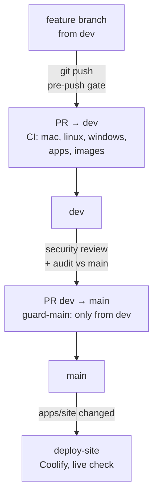

- Work on a feature branch from `dev`, open a PR to `dev`, then promote `dev` → `main` with a PR. `guard-main.yml` accepts PRs into `main` only from `dev`; the pre-push hook blocks direct pushes to `main`.
- **Pre-push gate** (`setup/hooks/pre-push`, enabled by the installer via `core.hooksPath`): runs on the exact commit being pushed. It checks shell/node syntax, YAML and skill frontmatter, the skill budget and routing, compose config, published numbers (`ai-os stats --check`), `.env` values in the push, the security scan (new findings only), unit tests and the install dry-runs.
- **CI:** `test-mac.yml`, `test-linux.yml` and `test-windows.yml` run the dry-run installers and unit tests. `test-apps.yml` tests `create-ai-os` and the site (unit and e2e), `image.yml` builds the images Coolify ships, and `deploy-site.yml` deploys `apps/site`.

### Contributing

Add a global skill as `ai-config/skills/<name>/SKILL.md`, an MCP server as `ai-config/mcp/<name>.yaml`, or a workflow as `workflows/<name>.md`. Then open a PR to `dev`; the gate and CI validate it. Guide: [`docs/sharing.md`](docs/sharing.md). Per-CLI invocation: [`docs/cli-reference.md`](docs/cli-reference.md). The README images are rendered from `docs/images/src/`.

## License

[MIT](LICENSE)
